# CabinPlay

[English](README.md) · [Türkçe](README.tr.md) · **Deutsch** · [Polski](README.pl.md) · [Français](README.fr.md) · [Español](README.es.md) · [Русский](README.ru.md)

Ein funktionierender Medienbildschirm für deine Lkw-Kabine in **Euro Truck Simulator 2**. Schau YouTube, höre Musik und folge der GPS-Karte des Spiels auf einem Tablet an der Windschutzscheibe, während du fährst.

  
  

  <a href="https://github.com/timurmert/ets2-cabinplay/blob/main/docs/media/cabinplay-demo.mp4">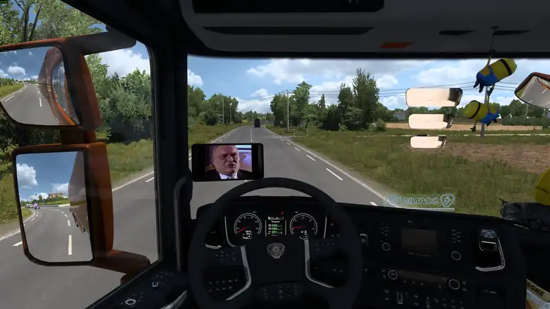</a> 
  ▶ <a href="https://github.com/timurmert/ets2-cabinplay/blob/main/docs/media/cabinplay-demo.mp4">Das ganze Video mit Ton ansehen</a>

  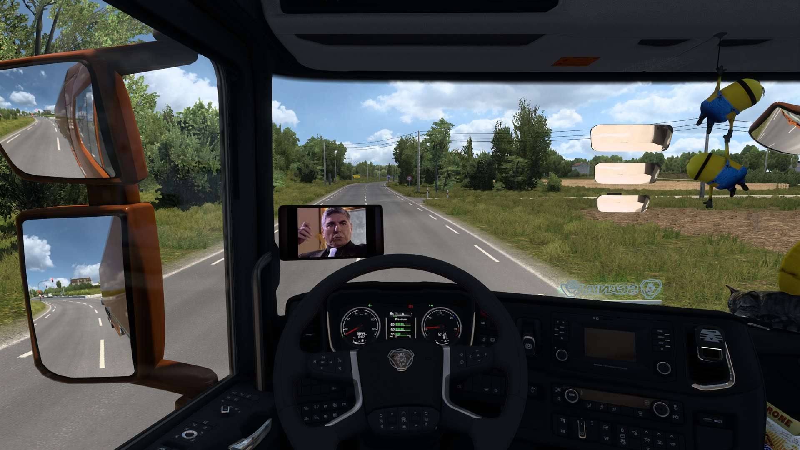
  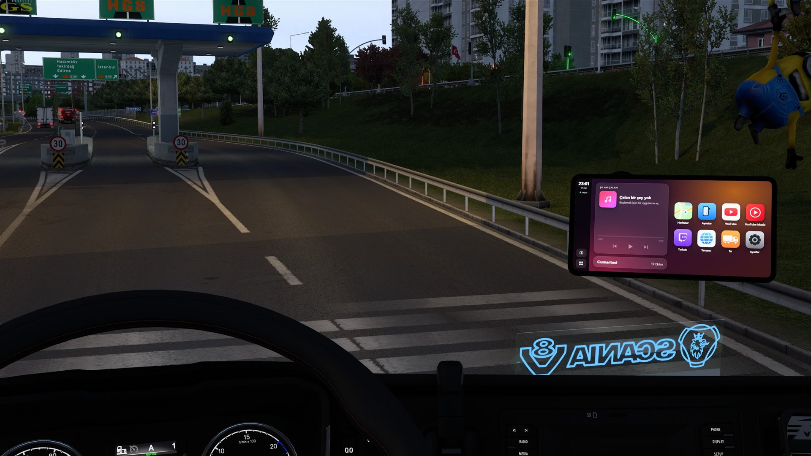

  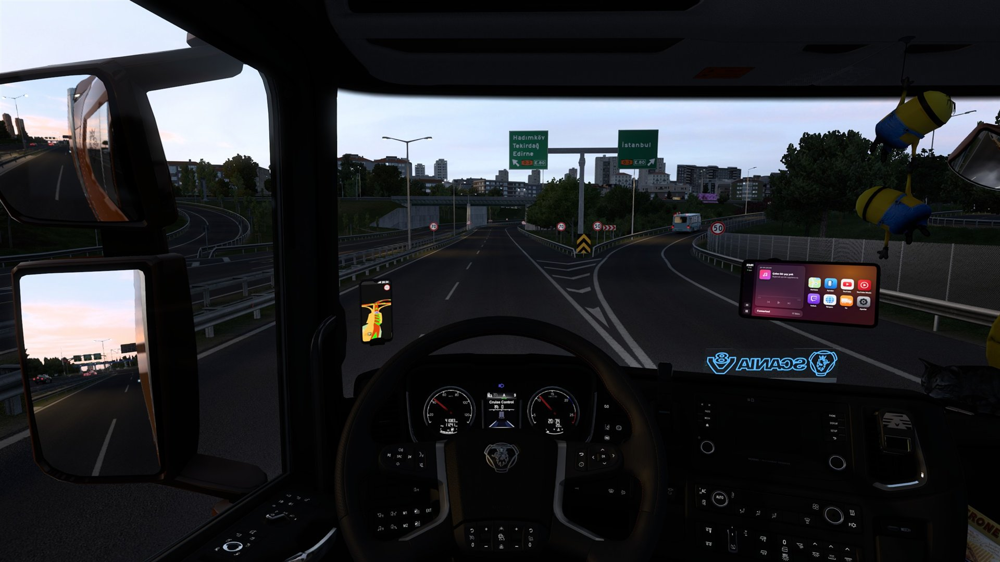
  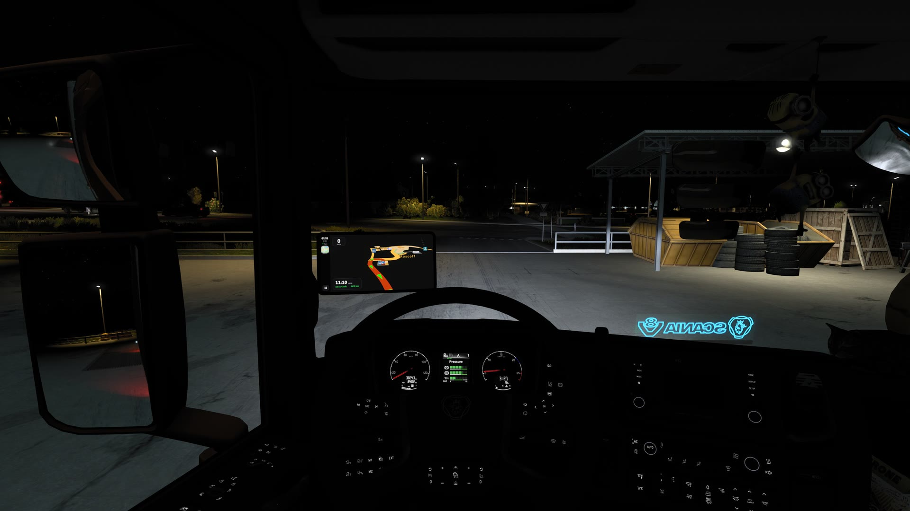
  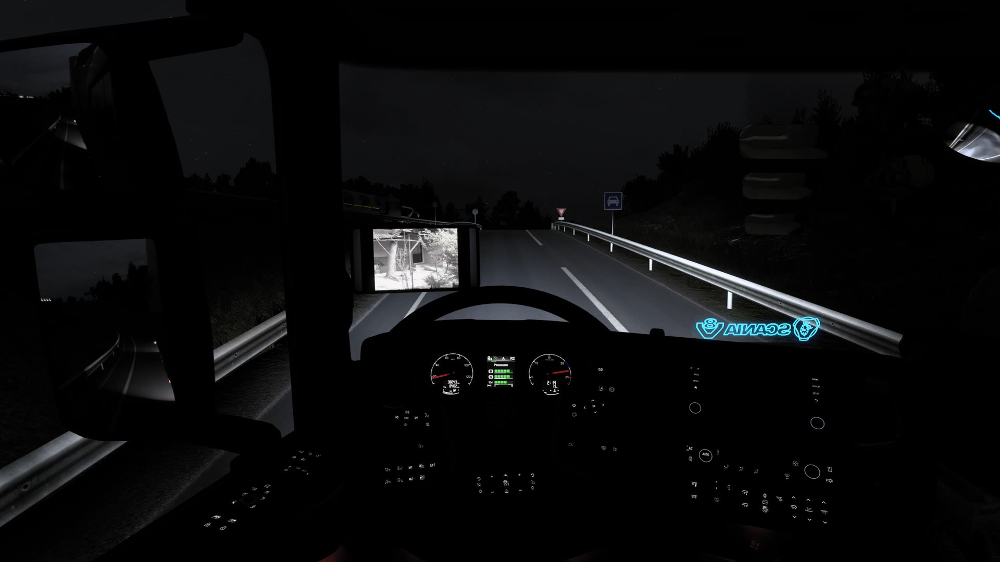

  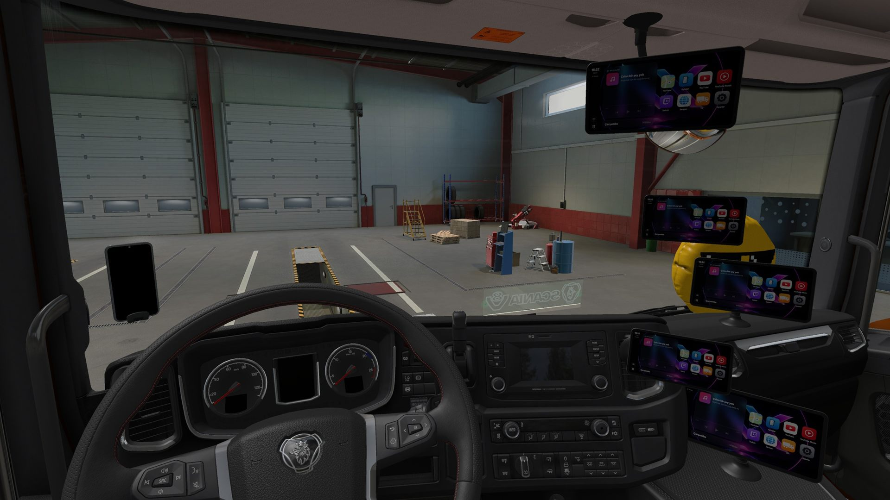
  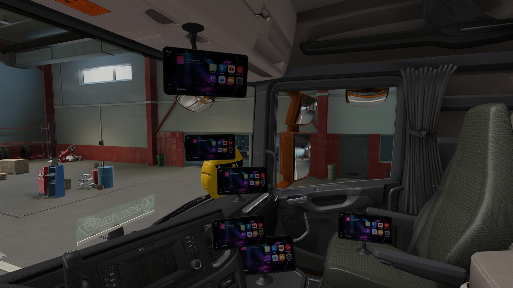
  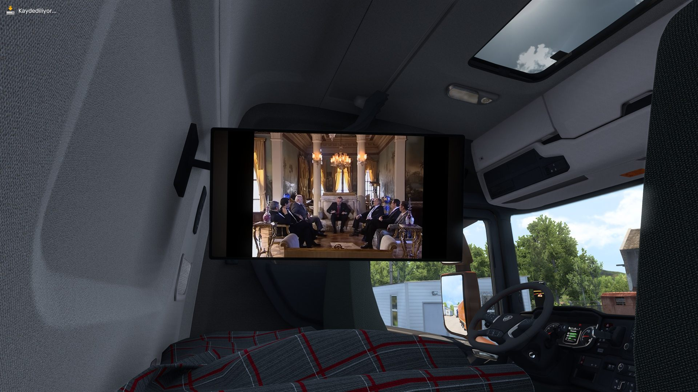

  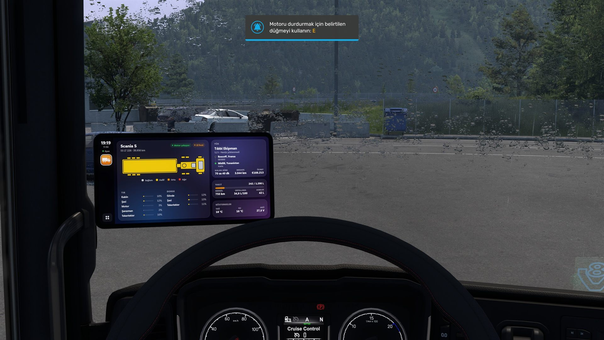
  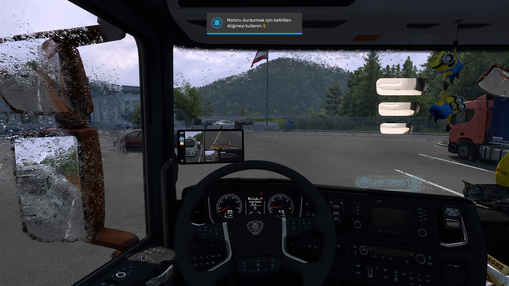
  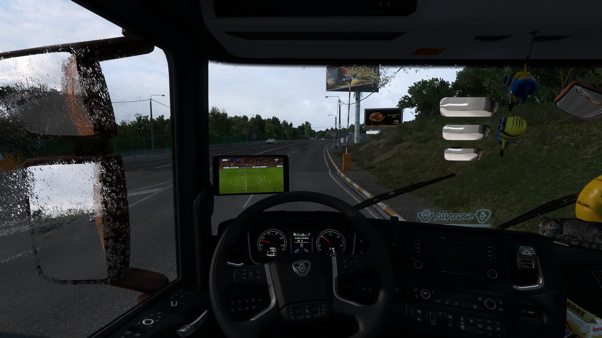

  <a href="https://www.virustotal.com/gui/file/468fd2ee5d0a35a9c45087a34f3be5ed2bea95f12796afad03c9cc5c95758d56">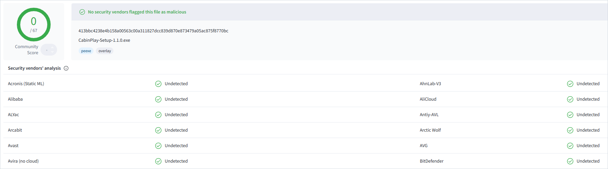</a> 
  🛡️ Keine der 68 Antiviren-Engines auf VirusTotal hat CabinPlay beanstandet. <a href="https://www.virustotal.com/gui/file/468fd2ee5d0a35a9c45087a34f3be5ed2bea95f12796afad03c9cc5c95758d56">Zum Bericht</a>

## Download

**[Lade die neueste Version herunter](https://github.com/timurmert/ets2-cabinplay/releases/latest)** und nimm die Datei `CabinPlay-Setup-x.y.z.exe`.

> 🛡️ **Virenscan:** Das Setup wurde auf VirusTotal von 68 Antivirenprogrammen geprüft, keines hat es beanstandet. **[Zum Bericht](https://www.virustotal.com/gui/file/468fd2ee5d0a35a9c45087a34f3be5ed2bea95f12796afad03c9cc5c95758d56)**

## Installation

Schließe das Spiel und wähle dann eine Variante:

**A) Setup (empfohlen).** Lade **CabinPlay-Setup-x.y.z.exe** herunter und starte es. Es findet das Spiel von selbst und braucht keine Administratorrechte. Meldet Windows, der Computer wurde geschützt, klicke auf *Weitere Informationen* und dann auf *Trotzdem ausführen* (das Setup ist nicht signiert).

**B) Von Hand.** Lade stattdessen **CabinPlay-x.y.z-manual-install.zip** herunter, entpacke es und kopiere drei Dinge daraus:

1. `cabinplay.scs` nach `Dokumente\Euro Truck Simulator 2\mod`
2. `plugin\cabinplay.dll` und `plugin\cabinplay.ini` in den Ordner `bin\win_x64\plugins` des Spiels (lege `plugins` an, falls er fehlt). So findest du den Spielordner: in Steam Rechtsklick auf das Spiel > *Verwalten* > *Lokale Dateien durchsuchen*.
3. den Ordner `app` an einen beliebigen Ort; starte dann einmal `CabinPlay.exe` darin. Danach startet es von selbst mit dem Spiel.

**Danach im Spiel:**

1. Starte das Spiel und bestätige den Hinweis zu den "SDK-Funktionen", der einmal erscheint.
2. Aktiviere im **Mod-Manager** **CabinPlay Screen**.
3. Baue in einer Lkw-Werkstatt **CabinPlay Screen** in einen Zubehörplatz an der Windschutzscheibe ein. Links gibt es drei Varianten, *Large* (13") und *Medium* (11") am Arm sowie *Compact* (10", an der Scheibe); im mittleren Platz gibt es *Centre* (11"), *Centre, Large* (13") und *Centre, X-Large* (15"), zum Fahrer gedreht (jeweils mit einer eigenen Variante für Rechtslenker).

Das war's. Der Bildschirm schaltet sich mit der Zündung ein. Mit dem Setup installiert, hält sich CabinPlay selbst aktuell: Eine neue Version wird beim Spielen heruntergeladen und beim Schließen des Spiels installiert und zeigt das auf dem Bildschirm an; unter *Einstellungen* > *Updates* kannst du es vorher fragen lassen oder abschalten. Zum Entfernen öffne in Windows *Einstellungen* > *Apps* oder starte `Uninstall.exe` in `%LocalAppData%\Programs\CabinPlay`; hast du von Hand installiert, lösche die kopierten Dateien.

## Bedienung

| Tastenkürzel | Funktion |
|---|---|
| `Ctrl+Alt+C` | Den Bildschirm im Spiel mit Maus und Tastatur bedienen; das Spiel pausiert solange (verlassen mit `Esc`) |
| `Ctrl+Alt+N` | Navigationskarte |
| `Ctrl+Alt+H` | Startbildschirm |
| `Ctrl+Alt+Leertaste` | Wiedergabe / Pause |
| `Ctrl+Alt+→` `←` | Weiter / zurück |
| `Ctrl+Alt+↑` `↓` | 10 Sekunden vor / zurück |
| `Ctrl+Alt+F` | Video im Vollbild |
| `Ctrl+Alt+PgUp` `PgDn` | Vorherige / nächste offene App |
| `Ctrl+Alt+S` | Zwei Apps nebeneinander, ein / aus |
| `Ctrl+Alt+X` | Die beiden Seiten tauschen |

Die Wiedergabe pausiert, wenn du das Spiel pausierst oder die Zündung ausschaltest. Die Sprache findest du unter **Einstellungen** auf dem Bildschirm. Hast du CabinPlay in den Einstellungen beendet, startet `Ctrl+Alt+C` es wieder.

Die App **Lkw** zeigt die Schäden an Lkw und Auflieger, die Ladung, den Kraftstoff und die Anzeigen. Die Ctrl+Alt-Tastenkürzel funktionieren auch, wenn das Spiel im Vordergrund ist, und ihre Tasten erreichen das Spiel nicht: Ein Tastenkürzel hupt nicht und schaltet nichts am Lkw.

Die App **Spiegel** zeigt die Spiegel des Lkw auf dem Bildschirm: den linken Spiegel, seinen Weitwinkelspiegel und, falls vorhanden, den Frontspiegel. Tippe auf einen, um ihn zu vergrößern.

Die App **Browser** öffnet jede Website: Gib oben in der Leiste eine Adresse oder eine Suche ein und tippe auf den Stern, um eine Seite auf der Startseite zu behalten. Auf Websites bleibst du angemeldet, und `Ctrl+Alt+F` zeigt das Video einer Seite im Vollbild. Zum Tippen brauchst du den Steuermodus (`Ctrl+Alt+C`).

**Nebeneinander** zeigt zwei Apps gleichzeitig, zum Beispiel links die Karte und rechts Musik oder den Browser: Tippe im Dock auf die Teilen-Taste und wähle für jede Hälfte eine App. Unter **Einstellungen** kannst du einen Hintergrund wählen, auch aus eigenen Bildern, die Tasten der Tastenkürzel ändern und jedes davon auf einen Knopf deines Lenkrads oder Gamepads legen.

**Weitere Plätze:** Außer an der Windschutzscheibe gibt es den Bildschirm in der Werkstatt auch für das *Dashboard* (Armaturenbrett), den *Air vent* (Lüftungsgitter), *Overhead* (Dach), den *Passenger seat* (Beifahrersitz), die *Console* (Mittelkonsole), den *Cup holder* (Getränkehalter, neuere Lkw) und die *Passenger side* (Beifahrerseite der Scheibe). Zum Zuschauen von der Liege gibt es den 27"-**CabinPlay TV**: an der Rückwand (Platz des Lichtpaneels), flach oder zum Kopfkissen ausgeschwenkt, oder an der Windschutzscheibe, flach oder zur Liege bzw. zum Fahrer gedreht. Im Scania S dreh den Kopf über den Blick nach hinten hinaus weiter nach rechts: Die Kamera wandert auf die Liege und bleibt am Kopfkissen stehen, mit Blick auf den Fernseher.

## Voraussetzungen

- Euro Truck Simulator 2 **1.61**, Windows 10 oder 11
- Kein DLC nötig
- Einzelspieler: funktioniert nicht mit TruckersMP
- Passt in 25 Lkw; nicht in den Renault E-Tech T

## Hilfe und Community

Fragen, Probleme und Neuigkeiten: **[tritt unserem Discord bei](https://discord.gg/hydrabon)**.

Um ein Problem zu melden, öffne **Einstellungen** auf dem Bildschirm, drücke **Fehlerbericht erstellen** und poste die Zip-Datei, die auf dem Desktop gespeichert wird.

**Das Video ruckelt oder friert ein?** Das Spiel lastet deine Grafikkarte voll aus. Stelle in den Grafikeinstellungen des Spiels die **Skalierung** auf 200 % oder weniger (meist ist 400 % die Ursache).

## Kontakt

**Zusammenarbeit und Sponsoring:** schreib an **[contact@hydrabon.com](mailto:contact@hydrabon.com)** oder erreiche uns auf [Discord](https://discord.gg/hydrabon).

**Beschwerden und Vorschläge:** schreib an dieselbe Adresse oder melde dich auf [Discord](https://discord.gg/hydrabon).

## Mitwirkende und Lizenz

Entwickelt von **HydRaboN**, unserem Community-Server und Software-Team. CabinPlay ist kostenlos und quelloffen unter der [GNU GPL v3.0 oder später](LICENSE): Du darfst es weitergeben und verändern, aber alles, was daraus entsteht, muss unter derselben Lizenz quelloffen bleiben und CabinPlay nennen. Nach Abschnitt 7 der Lizenz sind der Name *CabinPlay* und sein Logo nicht mitlizenziert; eine veränderte Version muss einen anderen Namen tragen. Enthält [MinHook](https://github.com/TsudaKageyu/minhook) (BSD 2-Clause).

CabinPlay ist ein inoffizielles Fanprojekt. Es steht in keiner Verbindung zu SCS Software, Google/YouTube, Twitch oder Apple und wird von ihnen nicht unterstützt.
